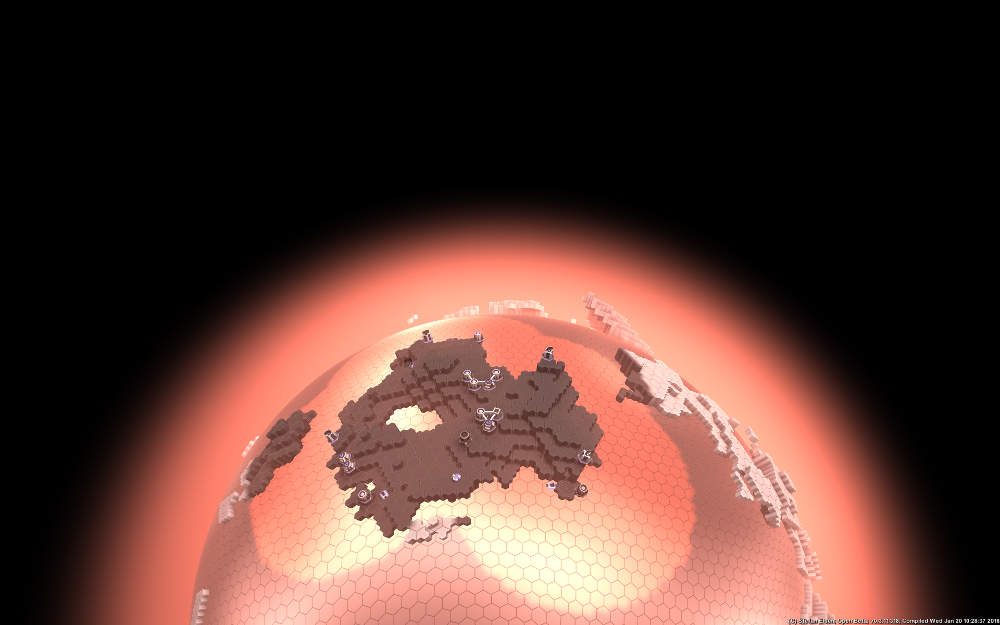

# Hexaverse

Hexaverse is a turn-based, multiplayer 4X strategy game played on **volumetric planets**. A hexagonal grid covers each planet and is stacked into 32 layers, so terrain can be dug out, built up, flooded or blasted away. All players act **at the same time** each round. They expand across the globe, mine resources that never run out but can be cut off, research upgrades, and fight with ground vehicles, planes and towers. The AI-controlled **Nexus** faction defends bases at up to 12 poles around the planet.

<p align="center"></p>

> [!IMPORTANT]
> **Hexaverse currently builds only on Windows, with the Visual Studio compiler (MSVC).** The code uses Direct3D 11, OpenAL, the Win32 API and MSVC extensions. You can build it with CMake or with Projector, but both need Windows and Visual Studio 2022 or newer. There is no Linux or macOS build. (The dedicated server has been run under Wine, but it is still built on Windows.)

> [!NOTE]
> **This is the `steam-public` branch:** `master` plus the Steamworks integration. It needs the Steamworks SDK, which isn't included. See [Steam build](#steam-build) and [Steam networking](#steam-networking).

## Purpose

IronFox developed Hexaverse between 2014 and 2022, and it was briefly available in Steam Early Access. This repository holds the complete game: the Windows client, the dedicated server, the Lua game scripts, the player documentation and the supporting tools. Development has stopped, and the full source is available here under the MIT License.

The last tagged release is `v0.9.12` (Feb 2021). `master` is at v0.9.13, which was never released.

## Composition

Hexaverse is a networked game. Even a single-player game runs a local server that the client connects to.

| Program | Language | Source | Role |
|---|---|---|---|
| **Visual Client** | C++ / Direct3D 11 | `client/` | The game itself: rendering, HUD, audio, input. Finds LAN servers and can start a local one. |
| **Console Client** | C++ | `client/` (without the visual and audio parts) | Headless client the server launches to run Lua AI players. |
| **Server** | C++ | `server/` | Dedicated server: simulates rounds, terrain and units, stores save games, hosts the Nexus. |
| **ControlConsole** | C++ | `ControlConsole/` | Command-line remote control for local servers. |
| ServerManager, Bake, DocumentationEditor | C# | own folders | GUI server manager, packaging tool, wiki editor. |
| BugReporter | C# (.NET 10) | `BugReporter/` | Optional crash reporter for your own releases. Not in the default packages, no report address built in ([docs/bug-reporter.md](docs/bug-reporter.md)). |
| BuildCounter, IncreaseVersion | C++ | own folders | Build-number and version bump helpers. |
| MetaServer | C# | `MetaServer.C#/` | Experimental, unfinished meta-server for a multi-planet universe. |

The code and data are split into these folders:

```
client/               Visual and console client, shaders, models, textures, sounds, game.ini
server/               Dedicated server, server variable declarations, tutorial save
clientServerShared/   Game model shared by client and server: grid, objects, research, protocol, Lua API
clientConsoleShared/  Starting and supervising a local server process (clients and ControlConsole)
globalShared/         Port numbers and process start helpers used by every program
lua/                  Research tree and unit attributes, AI, tutorial and resource-distribution scripts
predefinedPlanets/    Planet type templates (.ini)
ThirdParty/lua/       Lua 5.3.3, built as a static library
documentation/        In-game player wiki (DokuWiki syntax), its images, the PHP renderer, wiki2md.py
docs/                 Markdown documentation (developer guides and the converted game wiki)
cmake/                CMake helper modules and the OpenAL import-library definition
ArtWork/              Logos, store art, screenshots (PSDs in Git LFS)
issues/               Notes on investigated bugs
```

More detail is in [docs/repository.md](docs/repository.md) and [docs/architecture.md](docs/architecture.md).

## Server authority and cheat resistance

The server is fully authoritative. Clients only send requests, such as "queue this task", and the server checks each one (right phase, own unit, legal operation) before it changes anything. Movement, combat, terraforming, production and research are all resolved on the server.

The server also keeps track, for every faction, of what that faction can see right now and what it has seen before: which terrain cells its sensors cover, the terrain as it last looked everywhere else, and when each foreign unit came into or went out of view. A client is only ever sent what its faction is allowed to know. Hostile units out of sensor range, terrain changed out of sight, enemy orders and production queues, and attackers you can't see (you only get a vague trajectory) never reach the client. A modified client therefore has nothing hidden to reveal.

How this works in the code, and which host settings deliberately share more, is described in [docs/server-authority.md](docs/server-authority.md).

## Dependencies

| Dependency | Needed for | Notes |
|---|---|---|
| Windows 10/11 x64 | everything | Direct3D 11, Win32 windowing and console APIs. |
| **Visual Studio** 2022 or 2026, with *Desktop development with C++* and a Windows 10/11 SDK | C++ programs | Projects compile with `/std:c++latest` and the static CRT (`/MT`). The Direct3D 11 headers and libraries come from the Windows SDK. |
| **CMake** 3.21 or newer, **or** [Projector](https://github.com/IronFox/Projector) 1.5 or newer | C++ programs | Two equivalent ways to build. CMake uses the `CMakeLists.txt` files; Projector generates Visual Studio solutions from the `.solution`/`.project` files. |
| [DeltaWorks](https://github.com/IronFox/DeltaWorks) | C++ programs | IronFox's base library (`DeltaWorksCore`, `DeltaWorksEngine`), linked statically. It brings zlib, libpng, libjpeg, bzip2 and OpenSimplex noise, from vcpkg or bundled copies. CMake downloads DeltaWorks automatically if there is no checkout next to Hexaverse. |
| [vcpkg](https://vcpkg.io) | C++ programs, optional | Supplies zlib, libpng, libjpeg-turbo and bzip2 (listed in `vcpkg.json`). Ships with Visual Studio. Without it, CMake uses DeltaWorks' bundled copies. |
| OpenAL 1.1 SDK (Creative Labs) | Visual Client, optional with CMake | Only its import library `OpenAL32.lib` is used; the headers are bundled with DeltaWorks. CMake generates the import library itself if the SDK isn't installed. Projector needs the SDK. The runtime DLL and installer are committed in `client/`. |
| Lua 5.3.3 | client and server | Bundled in `ThirdParty/lua/`, nothing to install. |
| .NET Framework 4.x developer packs | C# tools | Plain `.sln`/`.csproj` files. Prebuilt copies of most tools are committed. |
| **Steamworks SDK** (Valve) | Visual Client and Server on this branch | Not included and not redistributable. Download it from Steamworks, see [Steam build](#steam-build). |
| Git LFS | cloning | `ArtWork/*.psd` is stored in LFS. |

Third-party code, assets and their licenses are listed in [docs/third-party.md](docs/third-party.md).

## Downloads

Prebuilt Windows packages are on the [Releases](../../releases) page: the full game, and a dedicated-server-only package. Unzip and start `client\Visual Client.exe`. Releases are built and published by GitHub Actions (see [docs/building.md](docs/building.md#github-releases)).

## Building

On Windows, with Visual Studio 2022 or newer installed. The full guide, with all options, configurations, packaging and troubleshooting, is in [docs/building.md](docs/building.md).

### With CMake

From a *Developer PowerShell for VS* (or with `VCPKG_ROOT` set):

```bat
git lfs install
git clone https://github.com/IronFox/Hexaverse.git
cd Hexaverse
cmake --preset vs-x64
cmake --build --preset vs-x64-release
```

CMake uses a DeltaWorks checkout in `../DeltaWorks` if there is one, or downloads the tested DeltaWorks commit. zlib, libpng, libjpeg and bzip2 come from vcpkg. Use the `vs-x64-bundled` preset to build without vcpkg. You can also open the folder directly in Visual Studio (*File → Open → Folder*), which reads the presets.

### With Projector

1. Clone [DeltaWorks](https://github.com/IronFox/DeltaWorks) and [Projector](https://github.com/IronFox/Projector), build Projector, and install the OpenAL 1.1 SDK.
2. Open `client/Client.solution` in Projector. The first time, it asks where `DeltaWorksCore.project`, `DeltaWorksEngine.project` and `lua.project` (`ThirdParty/lua/`) are.
3. **Generate**, **Open in Visual Studio**, and build `Visual Client` and `Console Client` in **Release | x64**.
4. Do the same for `server/Server.solution` and `ControlConsole/ControlConsole.solution`.

### Output

Both builds write the executables into the project folders, where the game expects them: `client/Visual Client.exe`, `client/Console Client.exe`, `server/Server.exe`, `ControlConsole/ControlConsole.exe` (Win32 builds are named `<Name> x86.exe`). Start `client/Visual Client.exe` and choose **Start local server…**, or start `server/Server.exe` first and join it from the server list. Running servers, ports and command lines are covered in [docs/running.md](docs/running.md).

## Steam build

This branch (`steam-public`) is `master` plus the Steamworks integration used for the Steam Early Access release: Steam authentication, Steam P2P networking, lobby-based server lookup, friend invites and the Steam upload scripts. Everything else in this README applies unchanged. The Steamworks SDK itself is **not** in the repository, because Valve's license doesn't allow redistributing it. You have to download it and copy it in yourself, and you must never commit it (`.gitignore` already excludes it).

### 1. Get the Steamworks SDK

1. Sign in at [partner.steamgames.com](https://partner.steamgames.com/) with a Steamworks account (anyone can create one, but shipping a game needs a paid app).
2. Download the SDK from [Steamworks SDK downloads](https://partner.steamgames.com/downloads/list) and unzip it. You need its `sdk` folder.

The code targets Steamworks SDK 1.65. Steam traffic goes through `ISteamNetworkingSockets`; the deprecated `ISteamNetworking` API is no longer used. Other SDK versions may need small fixes for renamed constants or changed signatures.

### 2. Put the SDK where the build finds it

There are two options:

- **Point CMake at the unzipped SDK.** Pass `-DHEXAVERSE_STEAMWORKS_SDK_DIR=C:/path/to/steamworks/sdk`. CMake then takes the headers from `public/steam/`, the import libraries from `redistributable_bin/` and `public/steam/lib/`, and copies `steam_api(64).dll` and `sdkencryptedappticket(64).dll` next to the executables after each build.
- **Copy it into `steam_sdk/`**, the layout the original branch and the Projector `.project` files use:

  | From the SDK (`sdk/…`) | To |
  |---|---|
  | `public/steam/*` | `steam_sdk/steam/` |
  | `redistributable_bin/steam_api.lib` | `steam_sdk/lib/win32/steam_api.lib` |
  | `public/steam/lib/win32/sdkencryptedappticket.lib` | `steam_sdk/lib/win32/sdkencryptedappticket.lib` |
  | `redistributable_bin/win64/steam_api64.lib` | `steam_sdk/lib/win64/steam_api.lib` (renamed) |
  | `public/steam/lib/win64/sdkencryptedappticket64.lib` | `steam_sdk/lib/win64/sdkencryptedappticket.lib` (renamed) |
  | `steam_api.dll`, `steam_api64.dll`, `sdkencryptedappticket.dll`, `sdkencryptedappticket64.dll` | `client/` and `server/` |
  | `tools/ContentBuilder/` | `steam_sdk/ContentBuilder/` (only for uploading, see below) |

  The 64-bit import libraries are renamed because the projects link `steam_api.lib` and `sdkencryptedappticket.lib` on both platforms. They still load the `…64.dll` files.

### 3. Set your app ID

The app ID is compiled in, so choose it before you build. The repository contains no Steam app ID. Use your own app's ID from the Steamworks site, or `480` (Valve's public *Spacewar* test app, which any Steam account can run) for trying things out. `480` is also the default.

- **CMake:** pass it when configuring, for example `cmake --preset vs-x64 -DHEXAVERSE_STEAM_APP_ID=<your app ID>`. CMake hands it to the code as `STEAM_APP_ID`, and after each build it writes a matching `steam_appid.txt` next to `Visual Client.exe` and `Server.exe`.
- **Projector:** change the default `STEAM_APP_ID` in `clientServerShared/network/steamInterface.h`, and put a `steam_appid.txt` that contains just the ID into `client/` and `server/`.
- **Separate dedicated server app:** Steam lets you publish the standalone server as its own (free) app, so server hosts don't need to own the game. In that case, build the Server a second time, in its own build folder, with the server app's ID.

### 4. Build

Build exactly as described in [Building](#building). With CMake, the Steam SDK is picked up automatically (`cmake/HexaverseSteam.cmake`), and configuring fails with a clear message if it's missing. With Projector, the `Visual Client.project` and `Server.project` files already list `steam_sdk/` as the *Steam SDK* library.

Only the **Visual Client** and the **Server** use Steam. `clientServerShared/network/steamInterface.h` defines `HAS_STEAM_API` for them (`HAS_WINDOW` or not `CLIENT`). The **Console Client** builds without it and has no Steam features.

### 5. Run

- **Steam must be running and signed in.** Both the Visual Client and the Server call `SteamAPI_Init()` at startup and quit if it fails.
- **`steam_appid.txt`.** CMake writes it next to `Visual Client.exe` and `Server.exe` (with Projector you add it yourself, see step 3). It lets you start the programs outside the Steam client during development. Without it, `SteamAPI_RestartAppIfNecessary()` has Steam restart the game through the Steam client. Don't ship it in a Steam depot, and don't commit it (`.gitignore` excludes it).
- **Ownership.** Your Steam account has to own the app, or be one of its developers, for `SteamAPI_Init()` to succeed. Any account can run `480`.
- **Ports.** In addition to the normal ports (base port `10247` by default: info `+0`, session `+1`, control `+2`), the server initializes a Steam game server on base port `+3` (Steam), `+4` (game) and `+5` (query). See `globalShared/ports.h`.
- **Steam overlay.** Notifications appear at the bottom right. *Invite friend* in the in-game menu opens the overlay invite dialog.

### 6. Upload to Steam

`repackAndUpload.bat.template` builds the release packages and uploads them with the SDK's ContentBuilder (`steamcmd`):

1. Copy `repackAndUpload.bat.template` to `repackAndUpload.bat` (it's ignored by Git) and put your Steam build account's user name and password into it. **Never commit those credentials.**
2. Copy the SDK's `tools/ContentBuilder/` into `steam_sdk/ContentBuilder/`, and add the four files below.
3. Run `repackAndUpload.bat`. It runs `repack.bat` (Bake with `mainBakeRecipe.txt` and `serverBakeRecipe.txt`, 7-Zip into `game.7z` and `server.7z`). It unpacks those into `ContentBuilder/content/` and `ContentBuilder/server_content/` and runs `steamcmd` with both app build scripts. Afterwards, set the new builds live on the Steamworks site.

`steam_sdk/ContentBuilder/full_build.bat`:

```bat
CALL recursive_rm.bat .\content
CALL recursive_rm.bat .\server_content

PUSHD ..\..
IF "%errorlevel%" NEQ "0" goto failed
CALL repack.bat
IF "%errorlevel%" NEQ "0" goto failed
%zip% x %rs1% -o.\steam_sdk\ContentBuilder\content -r
IF "%errorlevel%" NEQ "0" goto failed
%zip% x %rs2% -o.\steam_sdk\ContentBuilder\server_content -r
IF "%errorlevel%" NEQ "0" goto failed
POPD
CALL run_build.bat

CALL recursive_rm.bat .\content
CALL recursive_rm.bat .\server_content
exit /b 0

:failed
POPD
echo FAILURE
exit /b 1
```

`steam_sdk/ContentBuilder/run_build.bat` (the `user` and `password` variables come from `repackAndUpload.bat`):

```bat
builder\steamcmd.exe +login %user% %password% +run_app_build_http ..\scripts\app_build_game.vdf +run_app_build_http ..\scripts\app_build_server.vdf +quit
```

`steam_sdk/ContentBuilder/scripts/app_build_game.vdf` (the game). Replace `<GAME_APP_ID>` and `<GAME_DEPOT_ID>` with your app's ID and its depot ID from the Steamworks site. For the dedicated server, create `app_build_server.vdf` the same way, with the server app's and depot's IDs and `"contentroot" "..\server_content\"`. If you don't publish a separate server app, drop the second `+run_app_build_http` from `run_build.bat`.

```
"appbuild"
{
	"appid"       "<GAME_APP_ID>"
	"desc"        "Hexaverse Game Build"
	"buildoutput" "..\output\"
	"contentroot" "..\content\"
	"setlive"     ""
	"preview"     "0"
	"local"       ""
	"depots"
	{
		"<GAME_DEPOT_ID>" "depot_build_game.vdf"
	}
}
```

`steam_sdk/ContentBuilder/scripts/depot_build_game.vdf` (and `depot_build_server.vdf` with the server's depot ID):

```
"DepotBuildConfig"
{
	"DepotID"     "<GAME_DEPOT_ID>"
	"ContentRoot" "."
	"FileMapping"
	{
		"LocalPath" "*"
		"DepotPath" "."
		"recursive" "1"
	}
	"FileExclusion" "*.pdb"
	"FileExclusion" "*.hlsl"
	"FileExclusion" "*.psd"
	"FileExclusion" "*.exp"
	"FileExclusion" "*.iobj"
	"FileExclusion" "*.ipdb"
	"FileExclusion" "*.log"
	"FileExclusion" "*.cpp"
	"FileExclusion" "*.c"
	"FileExclusion" "*.h"
	"FileExclusion" "*.hpp"
	"FileExclusion" "*.lib"
	"FileExclusion" "*.project"
	"FileExclusion" "*.solution"
	"FileExclusion" "*.vcxproj"
	"FileExclusion" "*.filter"
	"FileExclusion" "*.user"
	"FileExclusion" "*.suo"
	"FileExclusion" "*.manifest"
}
```

## Steam networking

On `master`, clients find servers through LAN UDP broadcasts, `hosts.txt` and manually entered addresses. They connect over plain TCP, and a player is identified only by the nickname in the `Hello` message, with factions protected by a password challenge. The Steam build keeps all of that, but adds a second transport, Steam-based identities and lobby-based session lookup. The code is in `clientServerShared/network/steamInterface.*` (Steam API wrapper), `clientServerShared/network/net.*` (hybrid transport), `client/components/network.*` (server list, connecting) and `server/components/networkChannels.cpp` (login).

### Transport: Steam P2P next to TCP

`SteamNetwork::Server` and `SteamNetwork::HybridClient` (`net.h`) extend DeltaWorks' `TCP::Server` and `TCP::Client`. The server keeps listening on its TCP ports, and in addition it accepts Steam P2P connections through `ISteamNetworkingSockets` (`SteamGameServerNetworkingSockets()` in the server, `SteamNetworkingSockets()` in the client).

- **Connections.** The server opens a P2P listen socket (`CreateListenSocketP2P`) on virtual port `steamChannel` (0) and puts every accepted connection into one poll group. The client connects to the server's Steam ID with `ConnectP2P` on the same virtual port. Connection state arrives as `SteamNetConnectionStatusChangedCallback_t`, which `net.cpp` installs per listen socket and connection (`k_ESteamNetworkingConfig_Callback_ConnectionStatusChanged`) and routes to the right server or client. On `Connecting` the server calls `AcceptConnection`. On `Connected` it creates a `SteamPeer`, registers it by connection and Steam ID and raises `ConnectionEstablished`; a second connection from the same Steam ID replaces the first. The client raises `ConnectionEstablished` on `Connected`, and `ConnectionFailed` or `ConnectionLost` when the connection is closed by the peer or a problem is detected (Steam's own connect timeout replaces the old retry loop). Closing uses `CloseConnection` with linger, so queued reliable data is still delivered.
- **Same packages, different pipe.** A Steam peer (`SteamPeer`) sends exactly the bytes of a `TCP::Package` with `SendMessageToConnection(…, k_nSteamNetworkingSend_ReliableNoNagle)`. The game protocol and channels above it are unchanged, so the rest of the code doesn't care whether a peer is TCP or Steam. A single Steam message is limited to 512 KB (`k_cbMaxSteamNetworkingSocketsMessageSizeSend`), so larger packages, such as a world map update of several MB, are sent as several messages and reassembled on the other side using the size in the package header. Each connection may queue up to 64 MB, and a split package is queued completely or not at all; if it doesn't fit, the send fails and the peer is disconnected rather than receiving half a package. The send rate is clamped to between 512 KB/s and 16 MB/s instead of the library default of 256 KB/s, so large updates arrive in reasonable time.
- **NAT traversal and relay** come from the Steam Datagram Relay: both processes call `SteamNetworkingUtils()->InitRelayNetworkAccess()` at startup, and Steam routes P2P connections through its relays, so no port forwarding is needed.
- **Choosing a transport.** When a server-list entry has a Steam ID, the client connects through Steam (`client.ConnectToSteam(steamID)`). Otherwise, or with **Force TCP connections** checked in the server list, it connects over TCP to `host:basePort+1` as on `master`.
- All Steam callbacks are pumped from the network loop: `SteamNetwork::ResolveGlobalEvents()` calls `SteamGameServer_RunCallbacks()`, and `SteamInterface::Resolve()` calls `SteamAPI_RunCallbacks()`. The connection status callbacks are dispatched from these calls too (game server connections from the first, client connections from the second).

### Authentication

- **Client.** `Protocol::Hello` gains `steamID` and `ticket`. The client fills them with `SteamUser()->GetSteamID()` and a ticket from `SteamUser()->GetAuthSessionTicket()` (`SteamInterface::GenerateNewAccessToken`). A new ticket is requested for each login, and the previous one is cancelled.
- **Server.** `Hello()` in `networkChannels.cpp` puts the peer into `PreAuthentication` and calls `SteamInterface::Authenticate()`. That calls `BeginAuthSession()` through `ISteamUser`, because the server process is signed in to Steam too, or through `ISteamGameServer` if it isn't. Steam answers asynchronously with `ValidateAuthTicketResponse_t`. `OK` is accepted, and so are `VACBanned` and `NoLicenseOrExpired`, which Steam sometimes reports for valid players. On success, the Steam ID becomes the client's account ID (`client->accountID.steamID`) and the peer moves on to `PreFaction`.
- **Identity.** Factions belong to a Steam account (`faction->steamID`), so a player who reconnects, from any address, gets their faction back without a faction password (`HelloResponse::hasFaction`). The client sends its chosen nickname, and Steam persona names are used to show other players (`GetFriendPersonaName`).
- **Disconnect.** `SignalConnectionLoss()` calls `EndAuthSession()` for the Steam ID.
- **AI clients** don't use Steam. A scripted AI client logs in with `clientType = AIClient` and the server's random `aiAccessToken` in place of the ticket.
- **Optional: encrypted app tickets** (off). With `USE_CRYPTOGRAPHIC_LOGIN` and `CRYPTOGRAPHIC_SECRET` in `networkChannels.cpp`, the client sends an encrypted app ticket (`RequestEncryptedAppTicket`). The server decrypts it with the app's *encrypted app ticket key* from the Steamworks site and checks the app ID, the issue time (±180 s) and the Steam ID. That key is a secret: pass it in at runtime, and never commit it. By default `CRYPTOGRAPHIC_SECRET` is `nullptr` and the normal auth session ticket is used.
- **Optional: server owner check** (off). With `USE_STEAM_OWNER_AUTHENTICATION`, the client asks a server which Steam user runs it and compares the answer with the lobby owner before trusting the lobby's data (`SteamNetwork::GetAuthenticationState`). The query is a short P2P connection to the server's virtual port 1000: the server accepts it, sends the 8-byte Steam ID of its local user, and closes it.

### Session lookup

- **Lobby per server.** When a session starts, the server initializes a Steam game server (`SteamGameServer_Init`, authentication mode, anonymous logon, advertised with `SetAdvertiseServerActive`) and creates a Steam lobby. It ties the lobby to itself with `SetLobbyGameServer(publicIP, port, serverSteamID)` and publishes its state as lobby data: `version` (`SERVER_NAME`, the protocol version), `stamp` (Steam server time, refreshed every 10 s), `worldID`, `gameGoal`, `gameFlags`, `roundNumber`, `numFactionsOnline` and `numFactionsCreated`. The lobby is public, unless the game is configured as a private server (`GameFlag::PrivateServer`), in which case it is private. On shutdown the server clears `version`, makes the lobby private and leaves it.
- **Polling.** While not connected, and with **Poll Servers from Steam** checked in the server list, the client searches every 30 s (`SteamInterface::ProbeServers`). It calls `RequestLobbyList()` with these filters: `stamp` no older than 60 s, `version` equal to its own `SERVER_NAME`, and `numFactionsOnline` near 2. It also calls `RequestLobbyData()` for every lobby it already knows about. For each match, it reads the server's address and Steam ID with `GetLobbyGameServer()` and the game state from the lobby data, and adds or updates a server-list entry. Lobbies with an outdated stamp or another version are dropped. If the user was trying to join that lobby, the reason is shown.
- **Known lobbies** come from three places. The LAN UDP broadcast carries the server's lobby ID. Joining through the Steam friends list or an invitation starts the game with `+connect_lobby <id>`. *Invite friend* sends that same lobby. A client that is in a match sets the rich presence key `connect` to `+connect_lobby <id>`, so friends can join from Steam, and `+connect_lobby` on the command line makes the client connect to that lobby as soon as it appears.
- **Merging entries.** A server found by TCP and through Steam is a single entry with several addresses (`ServerInfo::addresses`). Entries are matched by address, or by lobby owner and world ID.

## Branches

| Branch | Content |
|---|---|
| `master` | The complete game, with every finished feature merged (aerial units, T2 upgrades, plants and advanced resources, alliances, statistics, the reworked Lua AI …). This is the branch to build. |
| `master-resource_bridge` | `master` plus the work-in-progress Lua **modding** framework (scripted structure types, first example: a Resource Relay). |
| `master-styled_highres` | `master` plus styled dark rendering and very large screenshot rendering. |
| `steam-public` | `master` plus the Steamworks integration (Steam login, P2P networking, lobby-based server lookup, upload scripts). The Steamworks SDK is not included, so it needs the SDK to build; see [Steam build](#steam-build). This is the branch you're reading. |

Releases are tagged `v0.3.19` to `v0.9.12`. Older experiments that were never merged (technite, pylons, orbital stations, a GUI renderer rework and more) are kept as `archive/*` tags. The full list, with dates and history notes, is in [docs/repository.md](docs/repository.md).

## Documentation

### Game documentation

The in-game player wiki, converted to Markdown, starts at **[docs/game/README.md](docs/game/README.md)**. It covers:

- [Controls](docs/game/controls.md), [terrain](docs/game/terrain.md) and [starting a server](docs/game/server-start.md)
- Game concepts, such as [rounds](docs/game/concepts/round.md), [resources](docs/game/concepts/resources.md), [compounds](docs/game/concepts/compound.md), [research](docs/game/concepts/research.md), [scanning range](docs/game/concepts/scanning-range.md) and [AI development](docs/game/concepts/ai-development.md)
- Configuration, such as [save games](docs/game/config/save-games.md)
- Every unit: structures, turrets, vehicle bases and planes ([unit list](docs/game/units/list.md))

The originals are the DokuWiki pages in `documentation/documentation/`, which the game also shows in-game. After editing them, run `python3 documentation/wiki2md.py` from the repository root to regenerate `docs/game/`.

### Developer documentation

| Document | Contents |
|---|---|
| [docs/building.md](docs/building.md) | Toolchain, dependencies, CMake and Projector builds, build outputs, packaging |
| [docs/running.md](docs/running.md) | Servers and clients, ports, command lines, game folder, save games, control console |
| [docs/gameplay.md](docs/gameplay.md) | Rules overview for programmers: phases, terrain, resources, units, sensors, Nexus |
| [docs/architecture.md](docs/architecture.md) | How client, server and shared code fit together: networking, world, object model, persistence |
| [docs/server-authority.md](docs/server-authority.md) | Why the server is authoritative and how it hides what a faction can't see |
| [docs/lua-scripting.md](docs/lua-scripting.md) | Research script, AI scripts, resource distributions, tutorial, Lua API |
| [docs/extending.md](docs/extending.md) | Adding unit and structure types, commands, protocol channels, server variables |
| [docs/tools.md](docs/tools.md) | Server Manager, Control Console, Bake, BugReporter, DocumentationEditor, BuildCounter, MetaServer |
| [docs/bug-reporter.md](docs/bug-reporter.md) | The optional bug reporter: configuration, upload protocol, adding it to a release |
| [docs/repository.md](docs/repository.md) | Repository layout, branches, tags, LFS and history notes |
| [docs/third-party.md](docs/third-party.md) | Bundled third-party code and assets, with their licenses |
| [docs/ai-contribution.md](docs/ai-contribution.md) | Which files were created or modified with AI assistance |

The full Lua API reference is [`lua/General Lua API Documentation.txt`](lua/General%20Lua%20API%20Documentation.txt).

## AI contribution

The game was written by IronFox. The documentation in this README and `docs/`, the CMake build, the CI and release workflows and the Markdown conversion of the player wiki were created with Claude (Anthropic's AI assistant) at IronFox's request. Apart from a few small fixes needed to build against the current DeltaWorks and compiler, the game code is unchanged. [docs/ai-contribution.md](docs/ai-contribution.md) lists every file that was created or modified.

## License

Hexaverse is released under the [MIT License](LICENSE). Bundled third-party components keep their own licenses, listed in [docs/third-party.md](docs/third-party.md).
