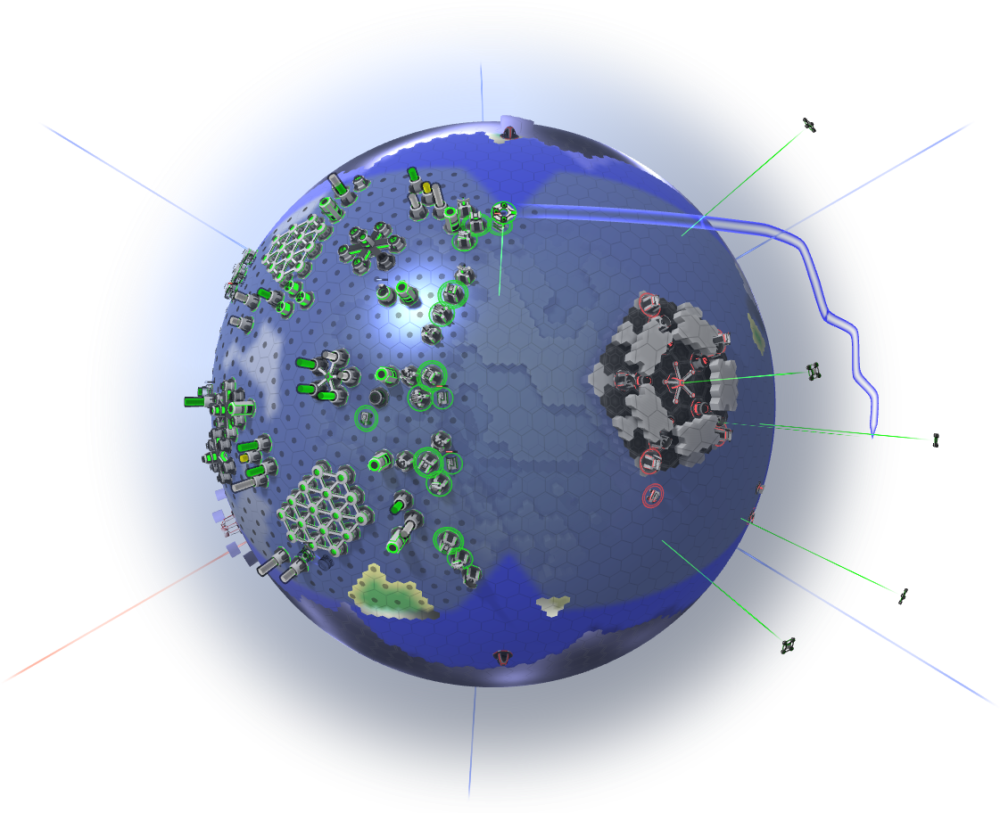

<!-- Generated from documentation/documentation/home.txt (DokuWiki syntax). -->

# An Introduction

Hexaverse is a turn based strategy game. Thrive and expand around the globe, or get whooped by someone that is better at that than you.

If you are new, check out [controls](controls.md), [best practices](concepts/best-practices.md), an explanation of the [terrain](terrain.md), or all [supported unit types](units/list.md).
You may also be interested in game concepts such as [round processing](concepts/round.md), [factions](concepts/faction.md), [sensory](concepts/scanning-range.md), [research](concepts/research.md), or [AI development](concepts/ai-development.md).

Hexaverse is a **networked** game.
It comes in two parts:
a **visual client** and a [dedicated server](server-start.md).
When starting the regular game (the visual client), it automatically locates any server running on the local area network and displays it in its server list.
If there are none, you may have to [start your own server](server-start.md).

To manage game save states check out the [save games](config/save-games.md) documentation.

## Requirements

Hexaverse is networked but may run isolated on the local system.
Typically, you need some network connection to compete against others.

Hexaverse currently only runs on windows.
The server can be started on Linux using Wine, but few have had any luck with the client so far.

You will need a video card capable of rendering Direct3D 10 content.
If yours is capable of doing that, then Hexaverse should run with an acceptable frame rate.
Otherwise check the client options, and reduce perhaps the shadow filtering setting a bit.
This requirement also means you need some screen. You should definitely have a screen.

Audio is optional.
If you want audio output, then you need an OpenAL-compatible sound card or onboard device.
OpenAL is pretty much generally supported, so if you are listening to music from your PC right now, then you're probably good.

Keyboard and Mouse, I guess.
The game makes use of left, middle (optional), and right mouse buttons, as well as the mouse wheel (also optional).
The right click is particularly important.
A keyboard (at least an emulated one) is necessary to enter your name, possibly a server address, and insults for your opponents when they raid your base.

## Error Reporting

Surprisingly, Hexaverse has bugs.
If you do encounter some, ideally the respective application automatically starts the [bug reporter](config/bug-reporter.md), allowing you to kindly submit a bug report.
Alternatively, you may manually start the bug reporter from the visual client menu (Main->Help->Report Bug).

---

## All pages

### General

- [Controls](controls.md)
- [Server Start](server-start.md)
- [Terrain](terrain.md)

### Concepts

- [Action Pool](concepts/action-pool.md)
- [AI Development](concepts/ai-development.md)
- [Best Practices](concepts/best-practices.md)
- [Compound](concepts/compound.md)
- [EMP Damage](concepts/emp-damage.md)
- [Faction](concepts/faction.md)
- [Ghost](concepts/ghost.md)
- [Horizontal Attack Range](concepts/attack-range.md)
- [Idle Units](concepts/idle.md)
- [Research](concepts/research.md)
- [Resources](concepts/resources.md)
- [Rounds](concepts/round.md)
- [Scanning Range](concepts/scanning-range.md)
- [Unit Commands](concepts/commands.md)
- [Unit Initiative](concepts/initiative.md)
- [Vehicle](concepts/vehicle.md)

### Configuration and tools

- [Bug Reporter](config/bug-reporter.md)
- [Game Configuration Folder](config/game-folder.md)
- [Interactive Visual Configuration](config/interactive-configuration-mode.md)
- [Save Games](config/save-games.md)
- [Server Configuration](config/server.md)
- [Server Control Console](config/control-console.md)
- [Server Manager](config/server-manager.md)

### Units

- [Unit Types and Components](units/list.md)

### Structures

- [Anti Aircraft Tower](units/structures/anti-aircraft-tower.md)
- [Cannon Tower](units/structures/cannon-tower.md)
- [Connector](units/structures/connector.md)
- [Fuel Container](units/structures/fuel-container.md)
- [Generator](units/structures/generator.md)
- [Laboratory](units/structures/laboratory.md)
- [Mine](units/structures/mine.md)
- [Mineral Container](units/structures/mineral-container.md)
- [Missile Launcher Tower](units/structures/missile-launcher-tower.md)
- [Munition Factory](units/structures/munition-factory.md)
- [Munition Storage](units/structures/munition-storage.md)
- [Nexus Port](units/structures/nexus-port.md)
- [Plane Factory](units/structures/plane-factory.md)
- [Radar Tower](units/structures/radar-tower.md)
- [Reactor Core](units/structures/reactor-core.md)
- [Rocket Launcher Tower](units/structures/rocket-launcher-tower.md)
- [Surveyor Tower](units/structures/surveyor-tower.md)
- [Uranium Storage](units/structures/uranium-storage.md)
- [Vehicle Plant](units/structures/vehicle-plant.md)
- [Vehicle Store](units/structures/vehicle-store.md)

### Turrets

- [Anti Aircraft](units/turrets/anti-aircraft.md)
- [Artillery](units/turrets/artillery.md)
- [Bomb](units/turrets/bomb.md)
- [Cannon](units/turrets/cannon.md)
- [EMP](units/turrets/emp.md)
- [Mechanic](units/turrets/mechanic.md)
- [Missile Launcher](units/turrets/missile-launcher.md)
- [Radar](units/turrets/radar.md)
- [Rocket Launcher](units/turrets/rocket-launcher.md)
- [Surveyor](units/turrets/surveyor.md)
- [Terraformer](units/turrets/terraformer.md)

### Vehicle bases

- [Catamaran Base](units/vbases/catamaran-base.md)
- [Heavy Base](units/vbases/heavy-base.md)
- [Hoverbase](units/vbases/hoverbase.md)

### Planes

- [Bomber](units/planes/bomber.md)
- [Cargo Plane](units/planes/cargo-plane.md)
- [Raptor](units/planes/raptor.md)
- [Sensor Drone](units/planes/sensor-drone.md)
