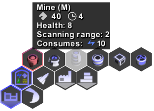

<!-- Generated from documentation/documentation/concepts/commands.txt (DokuWiki syntax). -->

# Unit Commands

During the [command phase](round.md) players can change the active command queue of each unit they control.
Factories (e.g. [vehicle plants](../units/structures/vehicle-plant.md)), towers, [laboratories](../units/structures/laboratory.md) and mobile units accept commands to execute during the following phases.
Most structures and mobile units allow queueing up to 16 commands each.

Commands are typically issued via their hexagonal [control buttons](../controls.md).
Movement and attack commands may be issued by right-clicking at hostile units or terrain locations.
This feature is available to mobile units and towers.
Use the **shift key** to queue up commands.
With the exception of very few commands (e.g. placing a unit that has been completed by a [vehicle plant](../units/structures/vehicle-plant.md)), all commands are queued rather than executed immediately.

Units with empty command queues may end up doing nothing at all.
Where appropriate, these units will be considered [idle](idle.md).
Offensive units (including towers) can fill their command queue on the fly if hostile targets are within safe attacking range.

---

[Game documentation index](../README.md)
