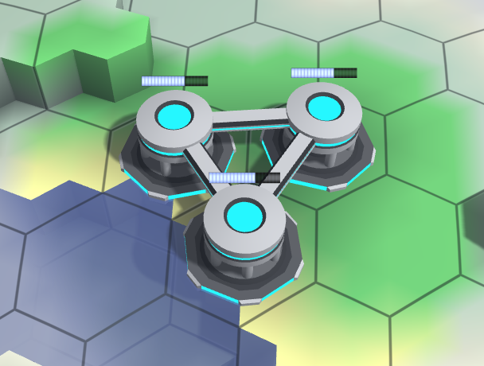

<!-- Generated from documentation/documentation/concepts/research.txt (DokuWiki syntax). -->

# Research

Research allows unlocking or improving units/unit-components over time.
The exact effect of research depends on the used [research script](../config/server.md).

Each enabled [laboratory](../units/structures/laboratory.md) contributes one research point per [round](round.md).
Unlock and improvement research will accelerate accordingly if multiple laboratories are enabled.
Research progress is **not** lost if the laboratory is destroyed.

The default research script locks all advanced units ([heavy](../units/vbases/heavy-base.md)/[catamaran](../units/vbases/catamaran-base.md) bases, [missile launcher](../units/turrets/missile-launcher.md), [reactor core](../units/structures/reactor-core.md), etc.) until they are sufficiently researched.
Additionally, it allows improving firing ranges of offensive turrets, and scanning range of radar turrets.
Improvements are currently scaled using a standard square root, thus generating diminishing return.

If hosting [your own server](../server-start.md), you may [override/reconfigure the research script](../config/server.md) as you see fit.

---

[Game documentation index](../README.md)
