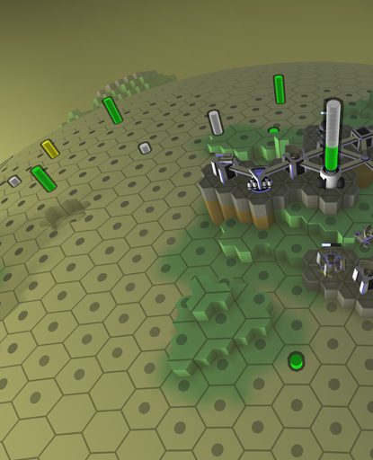

<!-- Generated from documentation/documentation/concepts/resources.txt (DokuWiki syntax). -->

# Resources

Resources in Hexaverse are infinite, but must be retrieved from the local planet using [mines](../units/structures/mine.md) or produced by other structures, such as [generators](../units/structures/generator.md).

## Natural Resources

Natural resources are retrieved by [mines](../units/structures/mine.md) from the planet core. Mines will retrieve the same amount of whichever natural resource is located beneath them each [round](round.md), provided a link to the planet core can be maintained.

When visualized on the terrain (see [controls](../controls.md) for details), they are shown as colored bars atop the terrain:

- **Green**:  Fuel
- **Gray**:  Minerals
- **Yellow**:  Uranium

The higher the bar, the greater the yield per turn.
Multiple natural resources may be found on the same cell, causing their bars to stack.

### Discovery

Natural resource coverage is initially unknown, and uncovered automatically within the [scanning range](scanning-range.md) of vehicles or towers featuring a [surveyor](../units/turrets/surveyor.md) turret.

## Other Resources

Currently only  Energy is produced artificially by [generators](../units/structures/generator.md) and [reactor cores](../units/structures/reactor-core.md), by converting  Fuel or  Uranium.
Many structures require a continuous supply of  Energy to operate.

 Time is also frequently shown as a resource icon, indicating the number of [rounds](round.md) necessary to complete an operation.

---

[Game documentation index](../README.md)
