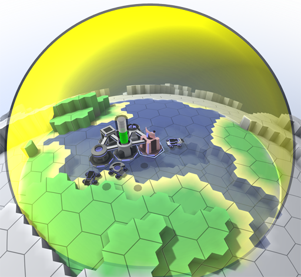
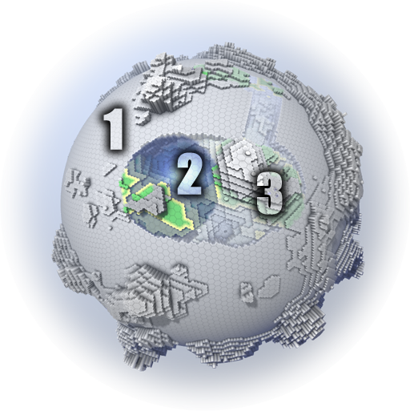

<!-- Generated from documentation/documentation/concepts/scanning range.txt (DokuWiki syntax). -->

# Scanning Range

All units provide a scanning range that reveals terrain and hostile units. The respective range is shown as a yellow shape around the selected unit.

Terrain and units outside the current scanning range of any friendly unit are at best preserved as memories, but not updated.
The older the memory, the less likely it is still current.
[Ghosts](ghost.md) of hostile units to which sensor contact has been lost are removed after 10 [rounds](round.md).

The terrain is shown in three shades:

1. Unvisited (this may look very similar to 3., depending on [server configuration](../config/server.md)))
1. Currently observed
1. Observed at some point but not anymore.

Obviously, it is benefitial to observe as much of the terrain surrounding your locations as possible, but it may be of higher priority to first focus on finding your enemies.

## Sky Sensory

[Planes](vehicle.md) have cylindrical sensors that allow coverage of a wider area, with limited ability to peer into the ground.
Coupled with increased mobility, and invisibility to regular radar, this allows planes to oberserve large stretches of the terrain with relative ease.

## Terrain Occlusion

Regular sensory has very limited capacity to scan through terrain.
Above surface, this forces [radar](../units/turrets/radar.md) units to be positioned in exposed locations.

Beneath the planetary surface, on the other hand, this circumstance renders your units practically blind.
The only unit types capable of scanning for subsurface activity are those equiped with a [surveyor](../units/turrets/surveyor.md) turret.
If you expect your enemies might attempt a subsurface attack, then early placement of [surveyor towers](../units/structures/surveyor-tower.md) can avert catastrophy.
See [best practices](best-practices.md) for details.

---

[Game documentation index](../README.md)
