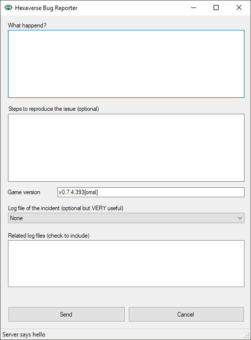

<!-- Generated from documentation/documentation/config/bug reporter.txt (DokuWiki syntax). -->

# Bug Reporter

Hexaverse reports bugs on its project page: https://github.com/IronFox/Hexaverse .
The visual client menu (Main->Help->Report Bug) opens that page.
Please describe what happened and, if you can, what you did before it happened.

## Log files

Think of the logs as the black boxes of the game. They help immensely in tracking down the cause of a bug, so please attach the related ones to your report.
They are stored in *`Documents\My Games\Hexaverse\[client|server|aiClient]\logs`*.
A crash of the client or the server also writes its error message to *`fatal.log`*.

## Bug reporter application

The default game packages don't include the bug reporter application.
Releases that do include it (in *`[install dir]\BugReporter\BugReporter.exe`*) start it automatically after a fatal error of the client or the server.
It collects the related log files and either sends them to the report address configured by whoever made that release, or saves them as a .zip file that you can attach to an issue on the project page.

---

[Game documentation index](../README.md)
