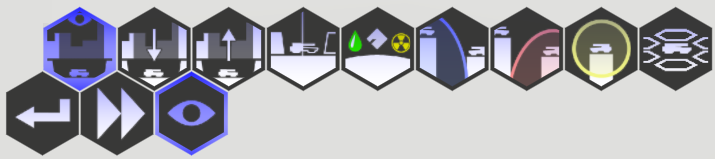

<!-- Generated from documentation/documentation/controls.txt (DokuWiki syntax). -->

# Controls

## Global Hot Keys

- **Escape** opens the menu, or aborts any currently visible dialog.
- **F3** creates a screenshot in *[game folder](config/game-folder.md)\\client\\screenshots\\*. **Shift+F3** causes the capture to retain its background transparency.
- **Alt+Enter** toggles borderless fullscreen window mode.
- **Tab** shows all participating players, alliances, chat messages, and whether factions have requested a [new round](concepts/round.md).
- **H** hides/restores all control buttons and the contact and event lists.

## Camera Control

- The **ASDW** keys can be used to rotate the camera around the currently focused point.
- The **Mouse Wheel**, or alternatively the **Up and Down Arrow Keys** zoom the camera in and out.
- Press and hold the **Right or Middle Mouse Buttons** to pan the camera around the planet.

## Unit Control

Units are selected by clicking on them. Clicking anywhere else will deselect any selected unit.

### Right Mouse Button

The right mouse button can be used to drag the camera around the globe.
When clicking it may trigger different events depending on the selected unit.

If a mobile unit is currently selected, then a motion instruction to the given location will be queued, assuming a valid route can be found.
If the location is occupied by a known hostile unit, and the selected unit can attack, then an attack is enqueued instead.
Right-clicking anywhere while an offensive tower is selected will always attempt to enqueue an attack.

Right-clicking with the **shift-key** held down queues the command at the end.
Otherwise the command queue is cleared first.
This behavior can be changed in the options dialog.

Right clicking anywhere with a [vehicle plant](units/structures/vehicle-plant.md) selected moves or unsets its gathering point.

### Unit Attacks

Offensive units can enqueue attacks at a specific location.
Usually, they provide a command in the bottom screen section to activate the [attack mode](concepts/attack-range.md).
Towers may also be directly instructued to attack a location by using a mouse right click.
The **CTRL** hotkey can be used to directly enter this mode without using commands.

Offensive units will fill their attack queue on demand if a hostile unit is within attack range.
Unless targets should be prioritized, it is commonly not necessary to issue commands manually.

### Terraformer Hotkeys

Additionally, [terraformer](units/turrets/terraformer.md)s support the following hotkeys to directly enqueue a particular construction command:

- **R** Construct a new [radar tower](units/structures/radar-tower.md)
- **M** Construct a new [mine](units/structures/mine.md)
- **G** Construct a new [generator](units/structures/generator.md)
- **F**/**V** Construct a new [vehicle plant](units/structures/vehicle-plant.md)
- **L** Construct a new [laboratory](units/structures/laboratory.md)
- **P** Construct a road to the selected location

Once any construction commands have been issued,
[Terraformer](units/turrets/terraformer.md) construction commands can be batched quickly by **alt+clicking** at any desired construction location.
This combination will re-enqueue the last construction command issued to any terraformer, regardless of wether the shift key is currently pressed.

### Idle Units

Players are encouraged to check for idle units by pressing the **space key** at the beginning of each [round](concepts/round.md).
The queue will iterate through all units currently considered [idle](concepts/idle.md).

## GUI Buttons

Hexaverse is mostly controlled via its hexagonal button configuration.
Some buttons may be disabled (semi-transparent), or perma-active (blue).
There are four button areas, with different functionality.

### Main Commands

The bottom left row of commands shows unit-independent commands.
Left to right, the commands are:

- **End Round** (shortcut: **Return**): Requests the current round to end. You should press this button when you are done issuing commands to your units. Press the button again to undo the request (possible as long as at least one other connected player has not yet requested a new round).

- **Auto End Round**: Toggles automatic round ending if the game finds no [idle](concepts/idle.md) units, no new hostile contacts, and no hostile activity during the last [animation phase](concepts/round.md). Processed only if this state was detected at the beginning of the round.

- **View**: Group of commands that affect the visual game representation.
   - **ClipTerrain** (shortcut: **End**): Toggles visual [terrain clipping](terrain.md).
   - **Clip-View Down** (shortcut: **Page Down**): Increases [clipping depth](terrain.md).
   - **Clip-View Up** (shortcut: **Page Up**): Decreases [clipping depth](terrain.md).
   - **Hide Objects**: Hides/shows all units on screen. Shadows are still rendered.
   - **Show Resources**: Toggles display of [resources](concepts/resources.md) on screen.
   - **Show Ranges**: Displays all friendly [sensor](concepts/scanning-range.md)/[attack](concepts/attack-range.md) ranges.
   - **Show Hostile Ranges**: Displays all hostile [sensor](concepts/scanning-range.md)/[attack](concepts/attack-range.md) ranges.
   - **Show Sensor Ranges**: Displays [sensor ranges](concepts/scanning-range.md) as yellow bubbles (on by default)
   - **Show Mobile Reach**: Displays an experimental translucent geometry where the currently selected mobile unit can reach in two rounds. Hard edges outline blocking terrain or buildings.
   - **Show Sky Grid** (shortcut: **Home**): Shows sub-orbital grid for more precise plane navigation, and sub-orbital sensor range visualization.
   - **Show Uncontrolled Explosion Ranges**: Displays spheres around units indicating their explosion radius if destroyed by attack.

### Contact and Event Lists

Friendly and hostile contacts are grouped by type and displayed at the top edge of the screen.
Repeatedly clicking on the same group will go through all members of that group.
Important events are listed beneath, such as unit losses and attacks that occurred during the last animation phase.

### General Commands

[Commands](concepts/commands.md) that are always applicable, or applicable to most units, are located in the bottom right of the screen.

Left to right, the commands are:

- **Undo** (shortcut: backspace): Drops the last task of the selected unit. Only applicable to active units.
- **Abort**: Drops all tasks of the selected unit.
- **Sleep**: Toggles sleep-state of the selected unit. Sleeping units are omitted in the [Idle Queue](concepts/idle.md).
- **Self Destruct**: Requests a confirmation, then instantly destroys the selected unit.
- **Votes**: Shows active votes
- **Messages**: Displays any waiting info messages. Pulses if there are any.
- **Open Menu**: Open the main game menu (also opens with the Escape key)

### Specific Unit Commands

Different visual [command](concepts/commands.md) trees are available depending on the type and state of the selected unit. Rest the mouse cursor atop any command to view its tooltip.
The currently expanded tree element is shown in blue outline.

---

[Game documentation index](README.md)
