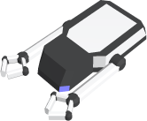

<!-- Generated from documentation/documentation/units/turrets/mechanic.prefix (DokuWiki syntax). -->

# Mechanic

- Cost: 30
- [Initiative](../../concepts/initiative.md): 100
- [Weight](../../concepts/vehicle.md): 2
- Base [scanning range](../../concepts/scanning-range.md): 3
- Can repair other vehicles/structures

This turret type can repair other structures and vehicles. It requires  to initiate repair.

Unlike most vehicles, a sleeping mechanic does not wake up when given new jobs. Repair (and other) jobs are queued and start once you wake the mechanic up with the [sleep](../../controls.md) command.

---

[Game documentation index](../../README.md)
