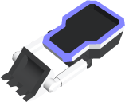

<!-- Generated from documentation/documentation/units/turrets/terraformer.prefix + units/turrets/terraformer.txt (DokuWiki syntax). -->

# Terraformer

- Cost: 40
- [Initiative](../../concepts/initiative.md): 100
- [Weight](../../concepts/vehicle.md): 2
- Base [scanning range](../../concepts/scanning-range.md): 4
- Construction: Converts 10 per round
- Terraforming: Can shape the surrounding terrain

This turret type can build structures in valid locations. It requires  to initiate construction.
Terraformers are very versatile vehicles, able to build every structure in the game.
Use them to construct defense structures in conquered areas, or dig tunnels beneath hostile territory.

---

[Game documentation index](../../README.md)
