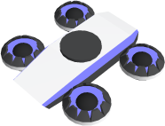

<!-- Generated from documentation/documentation/units/vbases/hoverbase.prefix + units/vbases/hoverbase.txt (DokuWiki syntax). -->

# Hoverbase

- Cost: 30
- [Initiative](../../concepts/initiative.md): 100
- Can climb 1 height level up
- Can safely fall down 5 height levels
- [Carrying capacity](../../concepts/vehicle.md): 1
- Base speed: 20 (supported by water)
- Base health: 4

Hoverbases are nimble, can stand virtually everywhere (except on pure air or lava), and climb mountains quickly.
They have low base health and turret carrying capacity, however, rendering them unsuitable for heavy turret bases, or extensive warfare.
It is generally recommended to replace this base with either [cat bases](catamaran-base.md), or [heavy bases](heavy-base.md), depending on terrain properties.
If the terrain is exceptionally mountainous, consider building roads and tunnels for your vehicles, using [terraformer](../turrets/terraformer.md) vehicles.

---

[Game documentation index](../../README.md)
